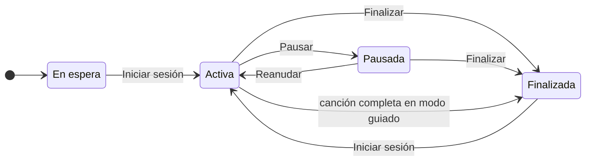
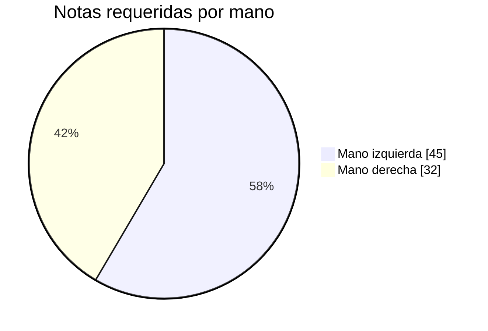
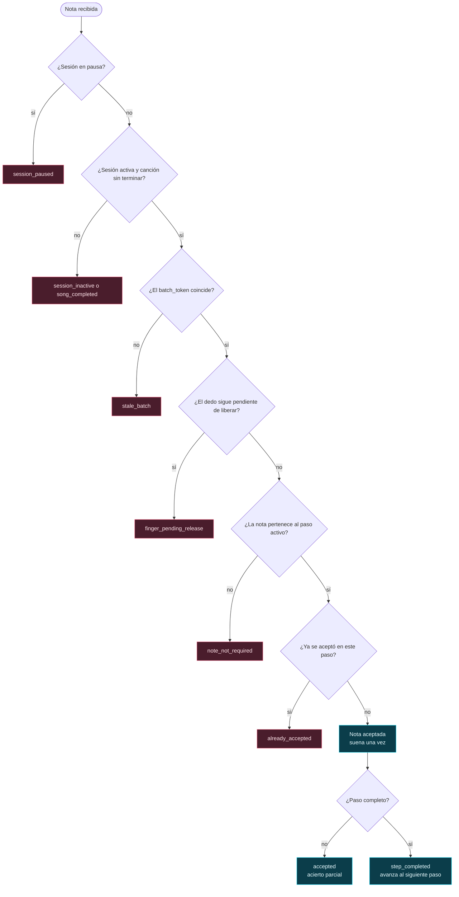
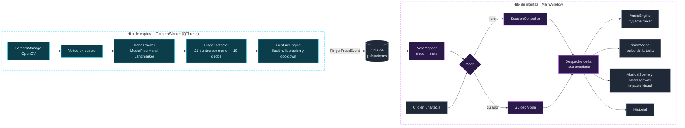
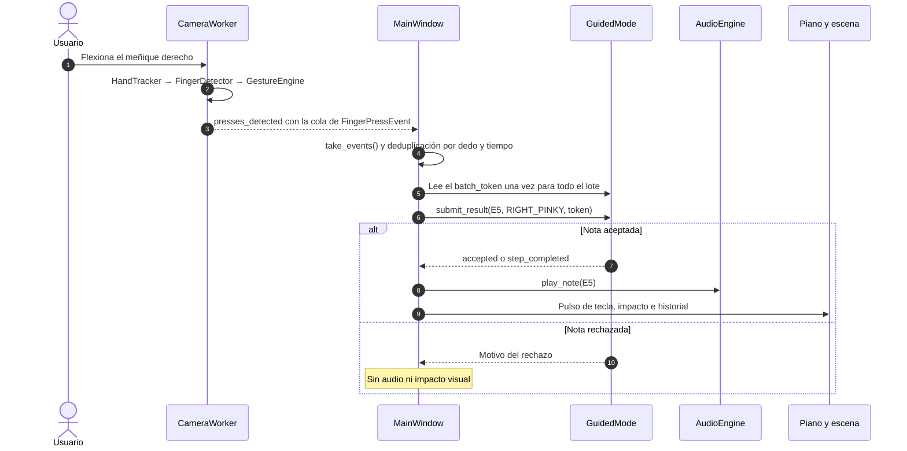
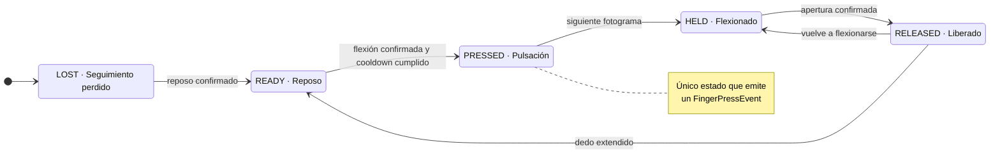
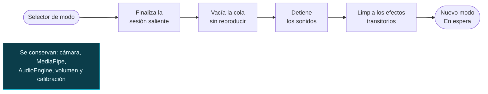
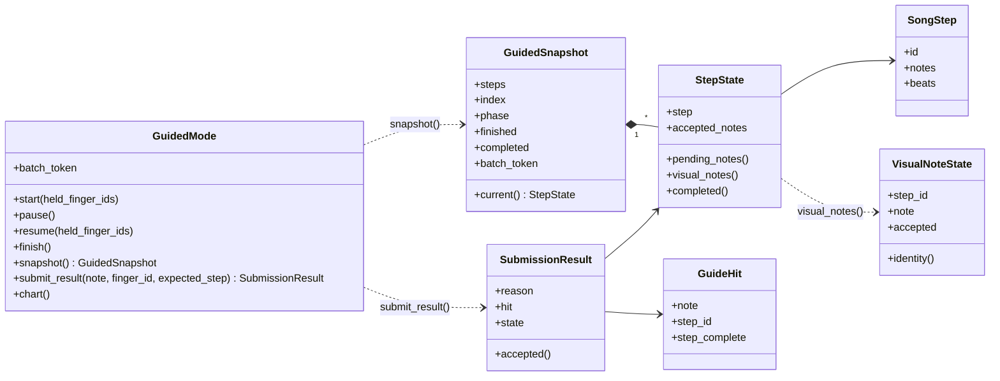

<div align="center">

# 🎹 FingerMelody

### Diez dedos, diez notas y una cámara web

Aplicación de escritorio en Python que convierte la flexión de los dedos de ambas manos en música.<br/>
Reconoce las manos con MediaPipe, reproduce notas sintetizadas y las acompaña con un escenario neón en PySide6.

[](https://www.python.org/)
[](https://doc.qt.io/qtforpython-6/)
[](https://developers.google.com/edge/mediapipe/solutions/vision/hand_landmarker/python)
[](https://opencv.org/)
[](https://www.pygame.org/)
[](https://docs.pytest.org/)
[](#%EF%B8%8F-requisitos)
[](#-estado-del-proyecto)

[**Mapa de notas**](#-mapa-de-dedos-y-notas) ·
[**La ventana**](#%EF%B8%8F-así-se-ve-la-ventana) ·
[**Modos**](#-modos-de-interpretación) ·
[**Arquitectura**](#%EF%B8%8F-arquitectura) ·
[**Instalación**](#-instalación-y-ejecución) ·
[**Uso**](#%EF%B8%8F-guía-de-uso) ·
[**Pruebas**](#-pruebas-automatizadas) ·
[**Estado**](#-estado-del-proyecto)

</div>

---

> [!IMPORTANT]
> Los modos libre y guiado están implementados y cubiertos por pruebas automatizadas. Todavía no hay resultados confirmados con cámara real, audio audible ni mediciones de rendimiento. Consulta el [estado del proyecto](#-estado-del-proyecto).

## ✨ En pocas palabras

FingerMelody es un proyecto académico sobre interacción musical sin instrumento físico. La cámara observa las dos manos, cada dedo equivale a una tecla y al flexionarlo suena su nota.

| | |
| --- | --- |
| 🖐️ **Diez dedos, diez notas** | Cada dedo toca una nota natural de C4 a E5. También se puede tocar con clics en el piano. |
| 👁️ **Visión por computador** | El modelo preentrenado Hand Landmarker de MediaPipe reconoce hasta dos manos. El proyecto no entrena modelos propios. |
| 🎯 **Gestos con confirmación** | Cada pulsación se confirma en varios fotogramas, tiene un tiempo mínimo entre repeticiones y exige abrir el dedo antes de volver a sonar. |
| 🎛️ **Calibración personal** | Guardar una pose de reposo y otra de flexión adapta los umbrales a cada mano. |
| 🔊 **Audio sintetizado** | Las diez notas se generan al arrancar, sin grabaciones externas. Varias pueden sonar a la vez. |
| 🌌 **Escenario neón** | Teclas iluminadas, barras luminosas, impactos líquidos, partículas e historial de notas. |
| 🧭 **Modo guiado** | Arreglo de *Jingle Bells* a dos manos en 49 pasos. |
| 🩺 **Diagnóstico** | Estado de cada dedo y tiempos de cada etapa de procesamiento. |

Quedan fuera del alcance actual la evaluación del ritmo, la grabación o exportación de interpretaciones, la carga de canciones desde archivos y la conservación de la calibración entre ejecuciones.

## 🎹 Mapa de dedos y notas

Las notas siguen el orden del teclado: la mano izquierda cubre de C4 a G4 y la derecha de A4 a E5.

```text
             MANO IZQUIERDA                            MANO DERECHA
◄──────────────────────────────────────►◄───────────────────────────────────────►
┌───────┬───────┬───────┬───────┬───────┬───────┬───────┬───────┬───────┬───────┐
│   C4  │   D4  │   E4  │   F4  │   G4  │   A4  │   B4  │   C5  │   D5  │   E5  │
└───────┴───────┴───────┴───────┴───────┴───────┴───────┴───────┴───────┴───────┘
  Pulgar  Índice  Medio   Anular Meñique  Pulgar  Índice  Medio   Anular Meñique
```

<details>
<summary><b>Tabla completa con identificadores y frecuencias</b></summary>

<br/>

La asociación se define en `NoteMapper` ([note_mapper.py](src/fingermelody/music/note_mapper.py)) y el diálogo **Configuración** muestra la asociación vigente. Las frecuencias siguen la afinación temperada con A4 = 440 Hz ([notes.py](src/fingermelody/music/notes.py)).

| Mano | Dedo | Identificador | Nota | Frecuencia |
| --- | --- | --- | --- | --- |
| Izquierda | Pulgar | `LEFT_THUMB` | C4 | 261,63 Hz |
| Izquierda | Índice | `LEFT_INDEX` | D4 | 293,66 Hz |
| Izquierda | Medio | `LEFT_MIDDLE` | E4 | 329,63 Hz |
| Izquierda | Anular | `LEFT_RING` | F4 | 349,23 Hz |
| Izquierda | Meñique | `LEFT_PINKY` | G4 | 392,00 Hz |
| Derecha | Pulgar | `RIGHT_THUMB` | A4 | 440,00 Hz |
| Derecha | Índice | `RIGHT_INDEX` | B4 | 493,88 Hz |
| Derecha | Medio | `RIGHT_MIDDLE` | C5 | 523,25 Hz |
| Derecha | Anular | `RIGHT_RING` | D5 | 587,33 Hz |
| Derecha | Meñique | `RIGHT_PINKY` | E5 | 659,26 Hz |

El piano de la pantalla tiene diez teclas blancas, una por nota. Las teclas negras solo representan la distribución del teclado y no suenan.

</details>

## 🖥️ Así se ve la ventana

Este es un esquema del modo guiado al empezar *Jingle Bells*, con el primer paso a medias. No es una captura real.

```text
┌───────────────────────────────────────────────────────────────────────────────────┐
│ FingerMelody  [Modo guiado ▼]   Volumen 70 % ════○──  [Configuración]  ( Activa ) │
├───────────────────────────────────────────────────────────────────────────────────┤
│ Pendientes: C4 · Izquierda · Pulgar                                               │
├───────────────────────────────────────────────────────────────────────────────────┤
│                                                  ┌──────────────────────────────┐ │
│ Franja superior reservada                        │ Dispositivo 0 · 640×480      │ │
│ para la tarjeta de cámara                        │                              │ │
│                                                  │      vídeo en espejo con     │ │
│                                                  │      puntos de cada mano     │ │
│                                                  │                     FPS: —   │ │
│                                                  │ [Iniciar][Detener][Detalles] │ │
│                                                  └──────────────────────────────┘ │
│                                    ▐██▌                                    ▐██▌   │
│                                    ▐G4▌                                    ▐E5▌   │
│                                                                            ▐E5▌   │
│    ▐C4▌                                                                    ▐E5▌   │
│                                    ▐██▌                                    ▐██▌   │
│                                    ▐G4▌                                    ▐E5▌   │
│                                                                            ▐E5▌   │
│    ▐C4▌                                                                   ▐✓E5▌   │
│ ~~~~~~~~~~~~~~~~~~~~~~~~~~~~~~ línea de activación ~~~~~~~~~~~~~~~~~~~~~~~~~~~~~~ │
│ ┌───────┬───────┬───────┬───────┬───────┬───────┬───────┬───────┬───────┬───────┐ │
│ │   C4  │   D4  │   E4  │   F4  │   G4  │   A4  │   B4  │   C5  │   D5  │   E5  │ │
│ │       │       │       │       │       │       │       │       │       │       │ │
│ └───────┴───────┴───────┴───────┴───────┴───────┴───────┴───────┴───────┴───────┘ │
├───────────────────────────────────────────────────────────────────────────────────┤
│ [Iniciar sesión] [Pausar] [Reanudar] [Finalizar]   Jingle Bells · 0/49            │
│ Última nota: E5                                          Historial: ( E5  gesto ) │
└───────────────────────────────────────────────────────────────────────────────────┘
```

Cómo leer el esquema:

- **Paso activo (fila más baja):** pide E5 y C4. E5 ya se aceptó y lleva la marca ✓. C4 sigue pendiente y espera en la línea de activación.
- **Pasos siguientes:** aparecen encima, más atenuados. La pantalla muestra hasta ocho pasos de anticipación.
- **Progreso `0/49`:** el contador solo avanza cuando el paso está completo.
- **Línea Pendientes:** indica la mano y el dedo de cada nota que falta.
- **Tarjeta de cámara:** se ubica en un hueco entre los carriles de las barras visibles. Si no cabe, como en este caso, el escenario le reserva una franja superior de 180 píxeles.
- **Modo libre:** desaparecen las barras, la línea **Pendientes** y el progreso, y la tarjeta de cámara queda en la esquina superior derecha.

## 🎮 Modos de interpretación

El selector **Modo libre / Modo guiado** del encabezado cambia de modo. La aplicación abre en **Modo libre** y la sesión empieza siempre **En espera**: no suena nada hasta pulsar <kbd>Iniciar sesión</kbd>.

| | 🎶 Modo libre | 🧭 Modo guiado |
| --- | --- | --- |
| Reglas | `SessionController` ([session.py](src/fingermelody/music/session.py)) | `GuidedMode` ([guided.py](src/fingermelody/music/guided.py)) |
| Notas que acepta | Cualquiera de las diez | Solo las del paso activo |
| Orden | Libre | Cualquier orden dentro del paso |
| Varias notas a la vez | Sí, de forma independiente | Sí, hasta completar el paso |
| Barras de canción | No | Sí, alineadas con sus teclas |
| Progreso | Contador de pulsaciones | `Jingle Bells · n/49` |
| Al pausar | Bloquea nuevas notas | Bloquea nuevas notas, congela las barras y conserva los aciertos parciales |

Los dos modos comparten la misma cámara, el mismo reconocimiento y el mismo motor de audio. Cambiar de modo no reinicia MediaPipe ni reconstruye el motor de audio.

### Ciclo de una sesión



- **Pausar** detiene los sonidos. La cámara sigue activa.
- **Iniciar sesión** y **Reanudar** exigen abrir los dedos que ya estuvieran flexionados antes de que puedan sonar.
- En modo guiado, una sesión nueva empieza desde el primer paso.

### 🎶 Modo libre

- Con la sesión activa, acepta cualquiera de las diez notas, sin una secuencia establecida.
- Si en un mismo lote de eventos llegan pulsaciones de varios dedos distintos, cada una se acepta por separado.
- Cada nota aceptada suena, hace pulsar su tecla, provoca un impacto visual en su carril y se añade al historial.
- No muestra barras de canciones.

### 🧭 Modo guiado: *Jingle Bells* a dos manos



| Dato | Valor |
| --- | --- |
| Pasos | 49 |
| Pasos con dos notas, una de cada mano | 28 |
| Pasos con una nota | 21 |
| Notas requeridas | 77 |
| Duración relativa total | 58 pulsos |

Cada paso tiene una o dos notas, nunca más, y la primera es siempre la melodía. En las frases 1, 2, 7 y 8, la mano derecha lleva la melodía E5 E5 E5 y la izquierda acompaña con C4 y G4. En las demás frases, la melodía va en la mano izquierda y la derecha acompaña.

<details>
<summary><b>Ver el arreglo frase por frase</b></summary>

<br/>

`+` une las notas que se tocan en el mismo paso. La primera nota de cada paso es la melodía.

| Frase | Melodía | Pasos | Pulsos |
| :---: | :---: | --- | :---: |
| 1 | Derecha | E5+C4 · E5 · E5+G4 | 4 |
| 2 | Derecha | E5+C4 · E5 · E5+G4 | 4 |
| 3 | Izquierda | E4+C5 · G4 · C4+E5 · D4 · E4+C5 | 6 |
| 4 | Izquierda | F4+A4 · F4 · F4+C5 · F4 | 4 |
| 5 | Izquierda | F4+A4 · E4+C5 · E4 · E4 | 4 |
| 6 | Izquierda | E4+C5 · D4 · D4+B4 · E4 · D4 · G4+D5 | 8 |
| 7 | Derecha | E5+C4 · E5 · E5+G4 | 4 |
| 8 | Derecha | E5+C4 · E5 · E5+G4 | 4 |
| 9 | Izquierda | E4+C5 · G4 · C4+E5 · D4 · E4+C5 | 6 |
| 10 | Izquierda | F4+A4 · F4 · F4+C5 · F4 | 4 |
| 11 | Izquierda | F4+A4 · E4+C5 · E4 · E4 | 4 |
| 12 | Izquierda | G4+B4 · G4 · F4+A4 · D4 · C4+E5 | 6 |

La duración relativa solo define la longitud y la separación de las barras. No exige mantener el gesto y no cambia la duración del sonido.

</details>

#### Modalidad Aprendizaje

Es la modalidad predeterminada y la única disponible en la interfaz.

- ✅ Las notas de un paso se pueden tocar en cualquier orden.
- ✅ Se admiten aciertos parciales y no hay límite de tiempo para completar el paso.
- ✅ Se puede tocar antes de que la barra llegue al piano.
- ✅ Pausar conserva los aciertos parciales.
- 🔁 Cada nota aceptada suena una sola vez por paso. Repetirla dentro del mismo paso no la vuelve a reproducir.
- 🚫 Las notas que no pertenecen al paso activo se rechazan y no suenan.
- ⏭️ El paso solo avanza cuando todas sus notas están aceptadas.
- ⏸️ Si una barra llega al piano antes de que la toques, espera en la línea de activación.

`GuidedMode` también incluye una modalidad interna de Coordinación, con una ventana temporal configurable (450 ms por defecto) para tocar juntas las notas de un paso. La interfaz todavía no permite seleccionarla.

<details>
<summary><b>¿Cómo decide <code>GuidedMode</code> si una nota cuenta?</b></summary>

<br/>

Cada entrada pasa por estas comprobaciones en orden. La primera que falla determina el motivo de rechazo que devuelve `submit_result()`.



En la modalidad Coordinación se añade una comprobación de la ventana temporal antes de mirar si la nota ya estaba aceptada.

</details>

## 🏗️ Arquitectura

### Vista general



La captura y el reconocimiento se ejecutan fuera del hilo gráfico. El hilo de captura publica solo el último fotograma y deja las pulsaciones nuevas en una cola. La ventana vacía esa cola, decide qué notas se aceptan y despacha cada nota aceptada una sola vez.

El paquete `music` no depende de Qt, de la cámara ni del audio. `AudioEngine` no importa PySide6. Los widgets no reproducen sonido: el piano emite la nota pulsada y la ventana decide si suena.

### De la flexión al sonido



En modo libre el recorrido es el mismo, pero la ventana consulta `SessionController.submit()` en lugar de `GuidedMode`.

### Estados de cada dedo



Cualquier estado pasa a `LOST` si el dedo deja de verse. Perder el seguimiento no cuenta como liberación: al reaparecer, el dedo necesita un reposo confirmado antes de otra pulsación.

`GestureEngine` mide los ángulos de las articulaciones y la extensión de la punta en índice, medio, anular y meñique. En el pulgar mide además la oposición, es decir, cuánto se acerca la punta a la palma. Estas medidas no cambian al girar o desplazar la mano entera.

<details>
<summary><b>Umbrales iniciales de <code>GestureConfig</code></b></summary>

<br/>

| Parámetro | Índice, medio, anular y meñique | Pulgar |
| --- | --- | --- |
| Ángulo de pulsación / liberación | 125° / 155° | 145° / 168° |
| Extensión de pulsación / liberación | 0,90 / 0,96 | 0,90 / 0,98 |
| Oposición de pulsación / liberación | — | 0,55 / 0,82 |

| Parámetro común | Valor |
| --- | --- |
| Fotogramas para confirmar pulsación, liberación y reposo | 2 |
| Tiempo mínimo entre pulsaciones del mismo dedo | 120 ms |
| Suavizado de las medidas | 0,72 |
| Duración del resaltado de la pulsación | 280 ms |

Si se guardan las dos poses de calibración, reposo y flexión, y la diferencia entre ellas es suficiente, el motor usa para ese dedo el punto medio entre ambas en lugar de estos valores.

</details>

### Cambio de modo



### Componentes

| Componente | Ubicación | Responsabilidad |
| --- | --- | --- |
| `MainWindow` | [interface/main_window.py](src/fingermelody/interface/main_window.py) | Compone la interfaz, posee la cámara y el único motor de audio, y coordina el despacho musical y los cambios de modo. |
| `CameraWorker` | [interface/camera_worker.py](src/fingermelody/interface/camera_worker.py) | Captura y procesamiento en un `QThread` independiente. |
| `CameraManager` | [vision/camera_manager.py](src/fingermelody/vision/camera_manager.py) | Abre el dispositivo con OpenCV, lee fotogramas y libera la cámara. En Windows prueba primero DirectShow. |
| `HandTracker` | [vision/hand_tracker.py](src/fingermelody/vision/hand_tracker.py) | Ejecuta el Hand Landmarker en modo vídeo, con hasta dos manos, y corrige la etiqueta izquierda/derecha para la imagen en espejo. |
| `FingerDetector` | [gestures/finger_detector.py](src/fingermelody/gestures/finger_detector.py) | Agrupa los 21 puntos de cada mano en dedos con identificador estable, como `LEFT_INDEX`. |
| `GestureEngine` | [gestures/gesture_engine.py](src/fingermelody/gestures/gesture_engine.py) | Interpreta flexiones y liberaciones, protege contra repeticiones y aplica la calibración. |
| `NoteMapper` | [music/note_mapper.py](src/fingermelody/music/note_mapper.py) | Asocia dedos y notas. Ofrece la consulta inversa nota → mano y dedo. |
| `SessionController` | [music/session.py](src/fingermelody/music/session.py) | Reglas, contador e historial del modo libre. |
| `GuidedMode` | [music/guided.py](src/fingermelody/music/guided.py) | Reglas y progreso del modo guiado. Define el arreglo de *Jingle Bells*. |
| `AudioEngine` | [audio/audio_engine.py](src/fingermelody/audio/audio_engine.py) | Reproduce las notas precargadas, controla el volumen y detiene sonidos. |
| `MusicalScene` | [interface/musical_scene.py](src/fingermelody/interface/musical_scene.py) | Integra escenario, teclado y tarjeta de cámara, y comparte la geometría de los carriles. |
| `NoteHighway` | [interface/note_highway.py](src/fingermelody/interface/note_highway.py) | Barras descendentes, línea de activación y efectos visuales. |
| `PianoWidget` | [interface/piano_widget.py](src/fingermelody/interface/piano_widget.py) | Teclado interactivo e iluminación de teclas. |

<details>
<summary><b>Reglas de despacho</b></summary>

<br/>

- Todos los eventos de un mismo lote comparten un único `batch_token` del modo guiado. Si un evento completa un paso, los eventos sobrantes de ese lote no pueden completar el siguiente.
- Cada clic en el piano se procesa como una entrada individual.
- Los eventos de gesto se deduplican por dedo y marca de tiempo.
- Solo el despacho de una nota aceptada produce audio, el pulso de la tecla, el impacto visual y la entrada de historial.
- Al iniciar o reanudar una sesión, los dedos que ya estaban flexionados deben abrirse antes de poder sonar. Con la cámara activa, también se descartan los eventos anteriores a ese momento que lleguen con retraso.
- Los fallos de reproducción se informan desde el motor de audio, no desde el reconocimiento ni desde `GuidedMode`.

</details>

<details>
<summary><b>Contrato de datos del modo guiado</b></summary>

<br/>

`GuidedMode` es la única autoridad del progreso. Las animaciones no cambian el índice musical ni generan audio. La interfaz dibuja a partir de instantáneas inmutables, y consultarlas no tiene efectos secundarios.



- `SongStep` define un paso inmutable: identificador, notas distintas y duración relativa.
- `VisualNoteState` identifica cada barra por `(step_id, note)`. Los acordes se representan con todas sus notas.
- `SubmissionResult` incluye el motivo de aceptación o rechazo: `accepted`, `step_completed`, `already_accepted`, `note_not_required`, `session_paused`, `finger_pending_release`, `stale_batch`, `session_inactive` o `song_completed`.
- `chart()` se mantiene por compatibilidad como proyección de una sola nota por paso. La vista de acordes no la usa.

El detalle está en [docs/guided-contract.md](docs/guided-contract.md).

</details>

<details>
<summary><b>Capa visual y audio</b></summary>

<br/>

**Escenario.** Se dibuja con `QPainter`, gradientes, trazados (`QPainterPath`), cachés de imágenes y temporizadores de Qt que se detienen cuando no hay nada que animar.

- Piano integrado en la parte inferior, sobre un fondo oscuro con iluminación azul y violeta.
- Colores por nota: azules y cian para la mano izquierda (C4–G4) y violeta y magenta para la derecha (A4–E5).
- Barras con núcleo translúcido, degradados, bordes luminosos, halos y estelas suaves mientras se mueven.
- Línea de activación ondulada sobre las teclas.
- Cada nota aceptada provoca en su carril un impacto líquido con salpicaduras, gotas, partículas, destellos, una columna de luz y reflejos sobre la tecla. Los efectos de varias notas son independientes y pueden coexistir.
- La llegada de una barra a la línea de activación no produce impactos ni sonido. Los impactos solo se activan con notas aceptadas.
- Si la animación detecta fotogramas lentos de forma sostenida, reduce las capas de halo y el número de partículas.

**Audio.** `AudioEngine` sintetiza las diez notas al arrancar y las deja en memoria.

| Parámetro | Valor |
| --- | --- |
| Duración de cada nota | 450 ms |
| Timbre | Fundamental y cuatro armónicos, con ataque, decaimiento y liberación hasta el silencio |
| Formato | 44 100 Hz, PCM de 16 bits con signo, estéreo |
| Buffer del mezclador | 512 muestras, unos 11,6 ms de cola interna |
| Voces simultáneas | 16 canales. Si están todos ocupados, se reutiliza uno. |

La cola interna del buffer no incluye el retardo del controlador de audio de Windows. No es una latencia acústica medida.

</details>

## 🧰 Tecnologías

Versiones fijadas en [requirements.txt](requirements.txt) para Python 3.11 de 64 bits en Windows:

| Tecnología | Versión | Uso en el proyecto |
| --- | --- | --- |
| Python | 3.11 (`>=3.11,<3.12` en `pyproject.toml`) | Lenguaje de la aplicación |
| OpenCV (`opencv-contrib-python`) | 4.14.0.94 | Captura de cámara, volteo de la imagen y dibujo de landmarks |
| MediaPipe | 1.1.1 | Hand Landmarker preentrenado, variante float16 |
| NumPy | 2.4.6 | Geometría de los dedos y síntesis de las muestras de audio |
| PySide6 | 6.12.0 | Interfaz, hilo de captura (`QThread`), temporizadores y dibujo con `QPainter` |
| pygame | 2.6.1 | Reproducción de audio con `pygame.mixer` |
| pytest | 9.1.1 | Pruebas automatizadas |

`requirements.txt` también fija las dependencias transitivas. MediaPipe 1.1.1 requiere `opencv-contrib-python`, que es la única distribución de OpenCV del entorno.

## ⚙️ Requisitos

| Requisito | ¿Obligatorio? | Notas |
| --- | :---: | --- |
| Windows de 64 bits | Sí | Las dependencias están fijadas para esta plataforma. La instalación en otros sistemas no está documentada ni verificada. |
| Python 3.11 de 64 bits | Sí | `pyproject.toml` exige `>=3.11,<3.12`. |
| Git | Sí | Para clonar el repositorio. |
| Pantalla de al menos 960 × 640 | Sí | Es el tamaño mínimo de la ventana. |
| Cámara web | No | Necesaria para tocar con gestos. Sin cámara se puede tocar con clics. |
| Salida de audio | No | Sin ella, la aplicación sigue funcionando sin sonido. |

El modelo `assets/models/hand_landmarker.task` forma parte del repositorio y se carga desde ahí al iniciar la cámara, sin descargas en cada ejecución.

## 🚀 Instalación y ejecución

En PowerShell:

```powershell
git clone https://github.com/Codemikey21/FingerMelody.git
cd FingerMelody
py -3.11 -m venv .venv
.\.venv\Scripts\Activate.ps1
python -m pip install --upgrade pip
python -m pip install -r requirements.txt --no-deps
python -m pip install -e . --no-deps
```

El lanzador `py -3.11` asegura que el entorno se cree con Python 3.11 aunque `python` apunte a otra versión. `.venv/` está excluido del control de versiones.

Abre la aplicación con el entorno activado:

```powershell
python -m fingermelody.main
```

| Opción | Valor por defecto | Ejemplo |
| --- | --- | --- |
| `--camera` | `0` (cámara principal) | `python -m fingermelody.main --camera 1` |
| `--width` / `--height` | `640` / `480` | `python -m fingermelody.main --width 320 --height 240` |

La resolución es una petición al controlador de la cámara, que puede entregar otra si no la admite. Un índice de cámara negativo o una resolución no positiva muestran un error y cierran la aplicación.

## 🕹️ Guía de uso

> [!TIP]
> Iniciar la cámara y empezar una sesión son acciones distintas. La cámara activa el reconocimiento de manos y la sesión permite que las notas suenen. Se puede iniciar una sesión sin cámara y tocar solo con clics.

### Primeros pasos

1. Abre la aplicación. La cámara está detenida, el modo libre está seleccionado y la sesión está **En espera**.
2. Pulsa <kbd>Iniciar</kbd> en la tarjeta de cámara. La imagen aparece en espejo, con los puntos y conexiones de cada mano.
3. Coloca las manos frente a la cámara, con las palmas visibles y los dedos extendidos. En <kbd>Detalles</kbd> debe aparecer **Ambas manos presentes** y los diez dedos deben pasar a **Reposo**.
4. Opcionalmente, [calibra los gestos](#calibración).
5. Elige **Modo libre** o **Modo guiado** en el selector del encabezado.
6. Pulsa <kbd>Iniciar sesión</kbd>.
7. Flexiona un dedo y mantenlo un instante: pasa a **Pulsación**, la nota suena una vez y aparece un aro en la punta del dedo. Si sigues flexionándolo, pasa a **Flexionado** sin volver a sonar. Ábrelo y flexiónalo de nuevo para repetir la nota. El pulgar cuenta cuando su punta se acerca a la palma.
8. Usa <kbd>Pausar</kbd>, <kbd>Reanudar</kbd> y <kbd>Finalizar</kbd> para controlar la sesión.
9. Pulsa <kbd>Detener</kbd> en la tarjeta de cámara para liberar la cámara y el modelo. Cerrar la ventana también la detiene.

El piano solo responde a clics mientras la sesión está activa.

### Controles

| Control | Ubicación | Función |
| --- | --- | --- |
| Selector **Modo libre / Modo guiado** | Encabezado, junto al título | Cambia de modo. La sesión saliente se finaliza y el nuevo modo queda en espera. |
| Deslizador de volumen | Encabezado | Ajusta el volumen de 0 a 100 %. Empieza en 70 %. |
| <kbd>Configuración</kbd> | Encabezado | Muestra el estado del audio, el dispositivo, la asociación dedo-nota y los botones de calibración. |
| Indicador de sesión | Encabezado, a la derecha | Muestra **En espera**, **Activa**, **Pausada** o **Finalizada**. |
| <kbd>Iniciar</kbd> / <kbd>Detener</kbd> | Tarjeta de cámara | Inician o detienen la captura y el reconocimiento. No controlan la sesión musical. |
| <kbd>Detalles</kbd> | Tarjeta de cámara | Abre un diálogo con indicadores técnicos y controles de audio. |
| <kbd>Iniciar sesión</kbd> <kbd>Pausar</kbd> <kbd>Reanudar</kbd> <kbd>Finalizar</kbd> | Fila bajo el escenario | Controlan la sesión del modo seleccionado. |
| Progreso y última nota | Fila bajo el escenario | En modo guiado, `Jingle Bells · n/49`. En ambos modos, la última nota aceptada. |
| Historial | Fila bajo el escenario, a la derecha | Últimas cuatro notas, con su origen (gesto o clic). La descripción emergente indica el dedo o el teclado. |
| <kbd>Silenciar audio</kbd> / <kbd>Activar audio</kbd> | Diálogo **Detalles** | Lleva la salida a cero conservando el nivel elegido, y lo recupera. |
| <kbd>Detener sonidos</kbd> | Diálogo **Detalles** | Corta las notas que siguen sonando. |
| <kbd>Reiniciar pulsaciones</kbd> | Diálogo **Detalles** | Pone a cero el contador de pulsaciones. En modo guiado no reinicia el progreso de la canción. |
| <kbd>Diagnóstico</kbd> | Diálogo **Detalles** | Muestra u oculta el panel de diagnóstico. |
| Contadores e indicadores | Diálogo **Detalles** | Modo, pulsaciones, manos detectadas, FPS, estado de cámara y audio, y estado de cada dedo. |

### Calibración

Los umbrales iniciales son un punto de partida, pero cada mano se mueve de forma distinta.

1. Inicia la cámara y coloca las manos frente a ella.
2. Abre <kbd>Configuración</kbd>.
3. Con los dedos extendidos, pulsa <kbd>Guardar reposo</kbd>.
4. Con el pulgar y los dedos que quieras ajustar flexionados, pulsa <kbd>Guardar flexión</kbd>.

El diálogo indica cuántos dedos se guardaron. Un dedo solo usa umbrales propios si tiene guardadas las dos poses. La calibración se conserva al detener y reiniciar la cámara y al cambiar de modo, pero se pierde al cerrar la aplicación.

### Tocar *Jingle Bells*

1. Selecciona **Modo guiado** y pulsa <kbd>Iniciar sesión</kbd>. Las barras empiezan a bajar.
2. Toca las notas del paso activo en cualquier orden. La línea **Pendientes** indica la mano y el dedo de cada nota que falta.
3. Cada nota aceptada suena, muestra ✓ en su barra y provoca el impacto en su tecla. Cuando el paso está completo, avanza al siguiente.
4. Al completar los 49 pasos, la sesión termina. Una sesión nueva empieza desde el primer paso.

## 🧪 Pruebas automatizadas

Con el entorno activado, desde la raíz del repositorio:

```powershell
python -m pytest
```

Las pruebas usan Qt en modo `offscreen`, sin abrir ventanas visibles. El reconocimiento de manos se sustituye por dobles de prueba y la reproducción se comprueba con mezcladores simulados. No se necesitan cámara ni altavoces.

| Área | Archivos | Qué comprueban |
| --- | --- | --- |
| 🎼 Música | `test_notes`, `test_free_play`, `test_guided_chords`, `test_guided_contract` | Escala y asociación de dedos, sesión libre, arreglo frase por frase, Aprendizaje y Coordinación, lotes, instantáneas y recorrido completo con exactamente 77 notas aceptadas. |
| ✋ Gestos | `test_finger_detector`, `test_gesture_engine`, `test_thumb_latency` | Identidad de los dedos, transiciones de estado, pulgar, cooldown, pérdida de seguimiento y calibración, sobre landmarks sintéticos. |
| 🎥 Visión y captura | `test_camera_manager`, `test_camera_worker`, `test_hand_tracker`, `test_hand_overlay`, `test_finger_overlay` | Cámara simulada, alternativa de backend, fallos de lectura, cola de eventos, validación del modelo y dibujo sobre la imagen. |
| 🔊 Audio | `test_audio_engine`, `test_synth` | Precarga, polifonía, volumen, dispositivo ausente y forma de las muestras. |
| 🖥️ Interfaz y escena | `test_interface`, `test_preview_window`, `test_musical_scene`, `test_neon_highway`, `test_molten_impact`, `test_reactive_free`, `test_free_public` | Piano, controles, carriles alineados con las teclas, tarjeta de cámara, efectos y comportamiento del piano libre. |
| 🧭 Integración guiada | `test_guided_highway`, `test_guided_snapshot_highway`, `test_guided_visual_sync`, `test_mode_dispatch` | Barras de acordes, impactos solo por notas aceptadas, cambios de modo, `batch_token`, dedos retenidos y cierre de temporizadores. |
| 🚪 Punto de entrada | `test_main` | Opciones de línea de comandos y arranque sin cámara. |

> [!NOTE]
> En la última ejecución registrada (17 de octubre de 2026, Windows, Python 3.11.9) se aprobaron 158 pruebas y pytest terminó con código de salida 0. Esa cifra corresponde a ese momento y puede cambiar a medida que evolucione el proyecto.

## 🩺 Diagnóstico y solución de problemas

Abre <kbd>Detalles</kbd> y activa <kbd>Diagnóstico</kbd>. El panel muestra:

- Para cada dedo con seguimiento: nombre, identificador, estado, ángulo, extensión, oposición del pulgar y tiempo de flexión.
- El último evento y su resultado, por ejemplo una nota sin reproducción o el motivo de rechazo del modo guiado.
- Los tiempos de captura, modelo, geometría y dibujo del último fotograma.
- El tiempo desde que se encola la pulsación hasta el despacho, y la duración de la llamada `play_note`.
- El resultado de la última calibración.

> [!NOTE]
> Estos valores son tiempos internos de cada etapa. No incluyen el retardo del controlador de audio ni del altavoz, así que no equivalen a la latencia que se percibe. Los FPS se calculan con los fotogramas procesados en el último segundo, con la detección incluida.

<details>
<summary><b>📷 Problemas con la cámara o el reconocimiento</b></summary>

<br/>

| Síntoma | Causa probable y solución |
| --- | --- |
| «No se pudo abrir la cámara…» | La cámara no está conectada, otra aplicación la está usando o Windows no permite el acceso. Cierra las demás aplicaciones y revisa *Configuración → Privacidad y seguridad → Cámara* para las aplicaciones de escritorio. |
| La cámara abierta no es la esperada | El índice 0 corresponde a otro dispositivo. Prueba `--camera 1`. |
| «Se perdió la conexión con la cámara…» | Fallaron cinco lecturas seguidas. Comprueba el dispositivo y vuelve a pulsar <kbd>Iniciar</kbd>. |
| «No se encontró el modelo de manos» o «El archivo del modelo de manos está dañado o incompleto» | Falta `assets/models/hand_landmarker.task` o no es válido. La cámara puede seguir mostrando imagen, pero el reconocimiento no se inicia. Restaura el archivo desde el repositorio. |
| «Mano detectada sin clasificación fiable» | El modelo no distingue con suficiente confianza si la mano es izquierda o derecha. Muestra la mano completa, con la palma hacia la cámara. |
| Un dedo abierto no llega a **Reposo**, o una flexión clara no suena | Los umbrales iniciales no se ajustan a esa mano. Guarda reposo y flexión en <kbd>Configuración</kbd> con la cámara en marcha. |

</details>

<details>
<summary><b>🔇 Problemas con el sonido o la sesión</b></summary>

<br/>

| Síntoma | Causa probable y solución |
| --- | --- |
| La sesión no reproduce nada | Comprueba que la sesión esté **Activa** y no solo la cámara iniciada. En modo guiado, solo suenan las notas pendientes del paso activo. |
| «Audio no disponible…» o no se oye nada | No hay un dispositivo de salida disponible o el audio está silenciado. Revisa el dispositivo predeterminado de Windows, el volumen del sistema, el deslizador y <kbd>Silenciar audio</kbd>. Cierra programas que usen el audio en modo exclusivo. |

</details>

<details>
<summary><b>🐍 Problemas con el entorno de Python</b></summary>

<br/>

| Síntoma | Causa probable y solución |
| --- | --- |
| `python` no es la versión 3.11 | Vuelve a crear el entorno con `py -3.11 -m venv .venv`. |
| PowerShell bloquea `Activate.ps1` | Ejecuta `Set-ExecutionPolicy -Scope Process -ExecutionPolicy Bypass` y activa el entorno de nuevo, o usa `.\.venv\Scripts\python.exe` directamente. |
| Conflictos con `cv2` | No instales `opencv-python` ni `opencv-python-headless` junto a `opencv-contrib-python`, porque los tres publican el mismo módulo `cv2`. |

</details>

## 📊 Estado del proyecto

**Implementado y verificado con pruebas automatizadas**

- [x] Modo libre con las diez notas, polifonía, historial y efectos visuales.
- [x] Modo guiado con el arreglo a dos manos, modalidad Aprendizaje, protección por lotes y cambios de modo seguros.
- [x] Integración visual de barras, piano y cámara en ambos modos.

**Validación física: abierta, sin completar ni aprobar**

- [ ] Reconocimiento de los diez dedos frente a una cámara real.
- [ ] Confirmación auditiva de las notas.
- [ ] Mediciones reales de FPS, uso de CPU y memoria, y latencia.
- [ ] Estabilidad en sesiones prolongadas.
- [ ] Comodidad de los cambios de posición de la tarjeta de cámara en modo guiado y lectura en pantallas de distintos tamaños.

> [!WARNING]
> Las comprobaciones del renderizado se han hecho con Qt en modo `offscreen` o con la cámara detenida y un audio simulado, lo que no equivale a una validación física. El proyecto todavía no garantiza rendimiento en tiempo real ni estabilidad prolongada.

**Limitaciones conocidas**

- Los umbrales de `GestureConfig` son un punto de partida, no una calibración universal. El anular y el meñique suelen moverse juntos y pueden necesitar ajustes propios.
- La calibración no se guarda al cerrar la aplicación.
- Solo hay una canción, definida en el código. La carpeta `songs/` está reservada y vacía.
- La modalidad Coordinación existe en el controlador, pero no en la interfaz.
- La asociación dedo-nota se puede consultar en <kbd>Configuración</kbd>, pero no editar desde la interfaz.
- Las dependencias solo están fijadas y probadas para Windows.

## 🗂️ Estructura del repositorio

```text
FingerMelody/
├── assets/
│   ├── models/hand_landmarker.task   # Modelo preentrenado de MediaPipe
│   └── sounds/                       # Reservada; las notas se sintetizan en código
├── docs/                             # Notas técnicas
├── songs/                            # Reservada para definiciones de canciones
├── src/fingermelody/
│   ├── main.py                       # Punto de entrada y opciones de línea de comandos
│   ├── audio/                        # AudioEngine y síntesis de notas
│   ├── core/                         # Reservado
│   ├── gestures/                     # FingerDetector, GestureEngine y marcas de pulsación
│   ├── interface/                    # Ventana, hilo de captura, escenario, piano y diálogos
│   ├── music/                        # Notas, NoteMapper, SessionController y GuidedMode
│   └── vision/                       # CameraManager, HandTracker y dibujo de manos
├── tests/                            # Pruebas con pytest
├── pyproject.toml                    # Paquete, versión de Python y configuración de pytest
└── requirements.txt                  # Dependencias fijadas
```

[docs/guided-contract.md](docs/guided-contract.md) describe el contrato vigente del modo guiado y su integración. [docs/architecture.md](docs/architecture.md) y [docs/guided-two-hands.md](docs/guided-two-hands.md) explican el recorrido de cámara, gestos y audio y las reglas del arreglo, pero contienen secciones anteriores a la integración pública del modo guiado.

## 👤 Autoría y licencia

Proyecto desarrollado por Miguel Angel Solano Diaz.

El repositorio no incluye por ahora un archivo de licencia. El modelo Hand Landmarker es un recurso oficial de Google MediaPipe, obtenido de <https://storage.googleapis.com/mediapipe-models/hand_landmarker/hand_landmarker/float16/1/hand_landmarker.task>. Sus condiciones de uso están en la [documentación oficial de MediaPipe](https://developers.google.com/edge/mediapipe/solutions/vision/hand_landmarker/python).
